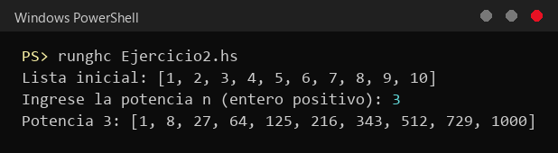
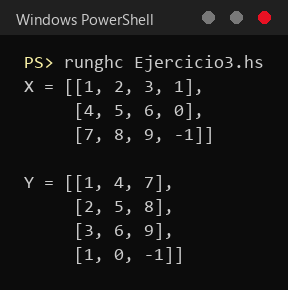
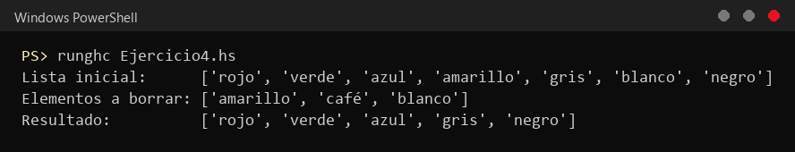

# Lab 12 - TDLC

Solución de los cuatro ejercicios del laboratorio en **Haskell**, usando funciones lambda.

## Video de demostración

[Ver video](ENLACE_DEL_VIDEO)

## Requisitos

- **GHC** (compilador de Haskell). Probado con GHC 9.10.3.
- No se necesitan librerías externas; solo se usan módulos incluidos con GHC (`Data.List`, `System.IO`, `Text.Read`).

### Instalación

1. Instalar **GHCup** siguiendo el comando de https://www.haskell.org/ghcup/ (en Windows se ejecuta desde PowerShell; se pueden dejar todas las opciones por defecto).
   - En Windows el instalador actualiza llaves de MSYS2 y puede mostrar varios `Could not update key`. Es normal y puede tardar varios minutos; no hay que cancelarlo.
2. Cerrar y volver a abrir la terminal.
3. Verificar la instalación:

   ```
   ghc --version
   ```

## Ejecución

Desde la carpeta del proyecto, cada archivo se ejecuta con `runghc`:

```
runghc Ejercicio1.hs
runghc Ejercicio2.hs
runghc Ejercicio3.hs
runghc Ejercicio4.hs
```

También se puede compilar a un ejecutable:

```
ghc Ejercicio1.hs
./Ejercicio1
```

### Ejercicio 1 - Ordenar diccionarios

Muestra la lista original y un menú con los keys disponibles. Se escribe el número del key por el cual ordenar.


### Ejercicio 2 - Potencia n-ésima

Pide la potencia `n` (entero positivo) y la aplica a cada elemento de la lista.



Para usar otra lista, modificar `lista` en el archivo, por ejemplo `lista = [1, 3, 2]`.

### Ejercicio 3 - Matriz transpuesta



Para usar otra matriz, modificar `x` en el archivo.

### Ejercicio 4 - Eliminar elementos



Para usar otras listas, modificar `colores` y `aBorrar` en el archivo.
